# 13-апта: жарықтандыру негіздері

**Тақырыбы:** геометрияға нормальдарды қосу, диффузиялық жарықтандыру
(Ламберт заңы), ambient құраушысы, нормаль матрицасы.

Негізі 12-аптадағы текстураланған куб пен еркін камера. Текстура біреу ғана
(`container.png`, sampler `ourTexture`, 0-бірлік), `loadTexture()` 11-аптадағыдай.

**Қосылғаны:** нормаль атрибуты (stride 5 → 8), `normalMatrix`, `lightPos`,
`lightColor`, `ambientStrength`. Төбелік шейдерде `FragPos` пен `Normal`
есептеледі, фрагмент шейдерінде ambient + diffuse.
**Өзгермегені:** UV координаттары, текстура коды, камера, тереңдік тесті,
culling, проекция.

## Құрастыру және іске қосу

```bash
cmake -S . -B build
cmake --build build
./build/bin/cg                 # қалыпты режим
./build/bin/cg --screenshots   # screenshots/ ішіндегі суреттерді қайта түсіреді
```

## Басқару

| Перне | Әрекет |
|---|---|
| Тінтуір / дөңгелек | қарау / fov |
| W A S D, Space, Ctrl, Shift | жүру, жоғары, төмен, жүгіру |
| **← → ↑ ↓, PgUp / PgDn** | жарық көзін x / z / y бойынша жылжыту (орбита өшірулі кезде) |
| **C** | жарықты алдыңғы жақтың ортасына қою: `(0, 0, 1.2)` (5-тапсырма) |
| **1** | жарық көзі шеңбер бойымен жүреді (1-тапсырма) |
| **2** | `max(..., 0.0)` алынып тасталады, ambient уақытша 0.4 (2-тапсырма) |
| **3** | `mat3(model)` (қате, А) ↔ `transpose(inverse)` (дұрыс, Б) (3-тапсырма) |
| **O / L** | `ambientStrength` үлкейту / кішірейту, `0.3 * dt`, 0…0.5 (4-тапсырма) |
| **4** | ambient-ті 0.1-ге қайтару |
| **5** | Гуро ↔ Фонг шейдингі (5-тапсырма) |
| **H** | жарық көзінің кубын көрсету / жасыру (Қ1) |
| **6 / 7 / 8** | бағытталған жарық / түрлі-түсті жарық / екі жарық көзі (Қ2 / Қ3 / Қ4) |
| P | ағымдағы күйді консольге шығару |
| R | камера мен жарықты бастапқы күйге қайтару |
| I / K / M | invert Y / pitch шектеуі / тінтуір режимі |
| F12 / ESC | скриншот / шығу |

> 10-аптадағы pitch шектеуі **L** пернесінде еді. L енді ambient-ті азайтады
> (4-тапсырма), сондықтан pitch шектеуі **K** пернесіне көшірілді.

Терезе тақырыбында ағымдағы күй жазылады: `Фонг | ambient 0.10 | орбита | ...`.

## Базалық бөлім

**1-қадам. Нормальдар.** `cubeVertices[]` массивінің әр жолына үш сан қосылды.
Бір жақтың алты төбесінде нормаль бірдей (flat shading):

| Жақ | Нормаль |
|---|---|
| Алдыңғы `z = +0.5` | `(0, 0, 1)` |
| Артқы `z = −0.5` | `(0, 0, −1)` |
| Оң `x = +0.5` | `(1, 0, 0)` |
| Сол `x = −0.5` | `(−1, 0, 0)` |
| Жоғарғы `y = +0.5` | `(0, 1, 0)` |
| Төменгі `y = −0.5` | `(0, −1, 0)` |

**2-қадам. Атрибуттар.** Stride үш жерде де `8 * sizeof(float)`. Нормаль
`location = 2`, offset `5 * sizeof(float)`, `glEnableVertexAttribArray(2)` бар.

**3-қадам. Төбелік шейдер.** `FragPos = vec3(model * vec4(aPos, 1.0))`
(тек model, жарық дүниелік кеңістікте есептеледі),
`Normal = normalMatrix * aNormal`,
`gl_Position = projection * view * vec4(FragPos, 1.0)`.

**4-қадам. Фрагмент шейдері.** `normalize(Normal)` қайта шақырылады
(интерполяция ұзындықты бұзады), `lightDir = normalize(lightPos − FragPos)`
(беттен жарыққа қарай):

```glsl
vec3 ambient = ambientStrength * lightColor;
vec3 diffuse = max(dot(norm, lightDir), 0.0) * lightColor;
FragColor = vec4(ambient + diffuse, 1.0) * texture(ourTexture, vTexCoord);
```

Жарық есебі `lighting()` функциясында. Ол Фонг (фрагмент) және Гуро (төбелік)
шейдерлеріне ортақ: бір GLSL жолы екі шейдерге де қосылады.

**5-қадам. Uniform-дар.** `lightPos = (1.2, 1.0, 2.0)`, `lightColor = (1, 1, 1)`.
`lightPos` 1-тапсырмада әр кадр өзгереді, сондықтан `setLightUniforms()` render
циклінің ішінде шақырылады. `normalMatrix` `drawCube()` ішінде, **әр куб үшін
бөлек** есептеледі:

```cpp
glm::mat3 normalMatrix = glm::transpose(glm::inverse(glm::mat3(model)));
glUniformMatrix3fv(uNormal, 1, GL_FALSE, glm::value_ptr(normalMatrix));
```

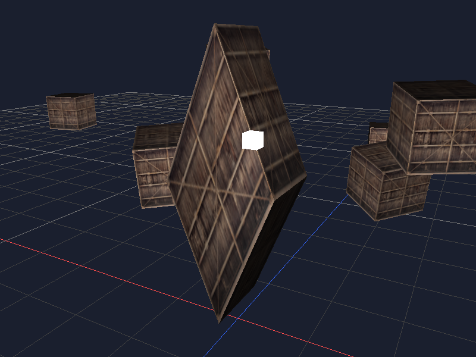

Тексеру:
1. Кубтың жақтары әртүрлі жарықтықта, көлемі айқын көрінеді.
2. Камерамен айналғанда жарық өзгермейді.
3. Жарыққа қарамаған жақ қара емес, күңгірт (ambient).
4. Жарықты ← → ↑ ↓ пернелерімен жылжытсаң, жарық басқа жақтан түседі.

## 1-тапсырма: жарық көзін қозғалту (1)

```cpp
lightPos = glm::vec3(1.5f * sin(t), 1.0f, 1.5f * cos(t));   // t = glfwGetTime()
```

`glUniform3fv(lightPos)` render циклінің ішінде тұр. Ақ кішкентай куб (Қ1)
жарық көзінің қайда екенін көрсетеді: ол айналған сайын әр жақ кезекпен
жарқырап, кезекпен күңгірттенеді.

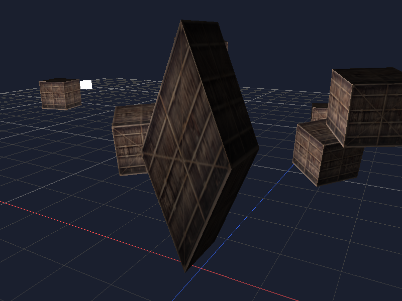

**Камераны қозғалтқанда жарық өзгере ме?** Жоқ. Diffuse тек `N` пен `L`-ге
тәуелді. Екеуі де дүниелік кеңістікте: нормаль модельге, `L` жарық көзі мен
фрагменттің орнына байланысты. Формулада камераның орны да, көру бағыты да
жоқ. Нақты Ламберт беті де жарықты барлық бағытқа бірдей шашыратады, сондықтан
кез келген жерден бірдей көрінеді.

**Камераға тәуелді болуы керек құраушы** — **айналық (specular)** құраушы
(жылтыр). Ол көру бағыты шағылған сәулеге жақын болғанда ғана көрінеді. Ол үшін
`viewPos` uniform, halfway vector және `shininess` керек (14-апта).

## 2-тапсырма: `max` функциясын алып көру (2)

```glsl
float d = dot(norm, lightDir);
return useMax ? max(d, 0.0) : d;     // 2 пернесі: useMax = false
```

Жарық оң жақта `(2.5, 0.3, 0.5)`, камера сол жақтан қарайды, ambient 0.4.

| `max` жоқ (қате) | `max` бар (дұрыс) |
|---|---|
| 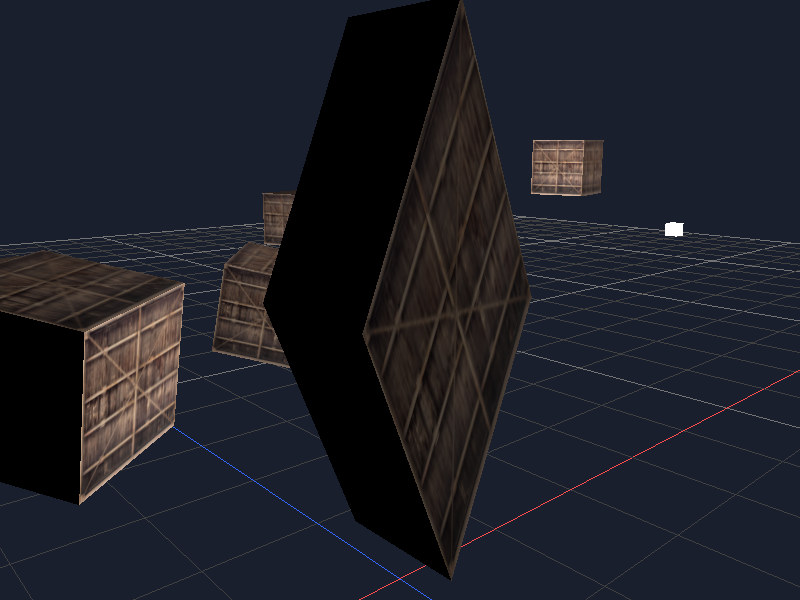 | 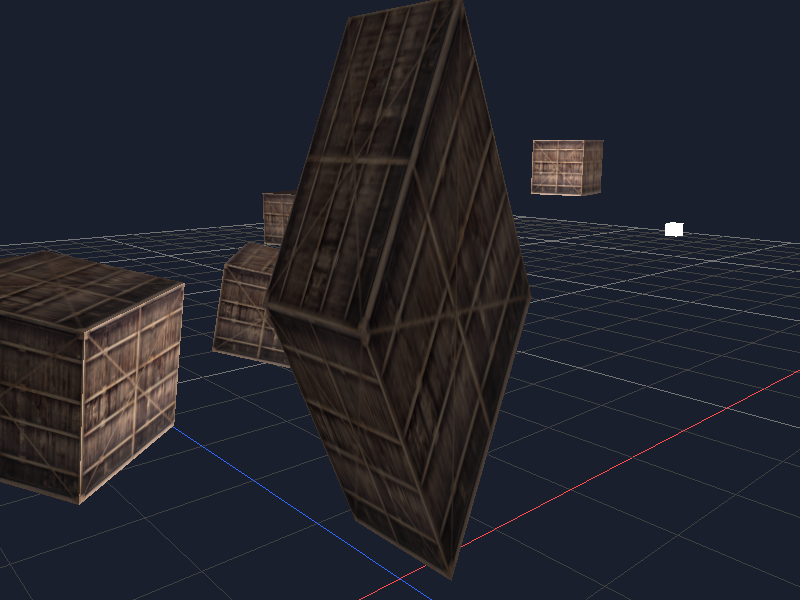 |

Жарыққа қарамаған жақтар `max` жоқта **толық қара**, ал `max` бар кезде
ambient-тің арқасында күңгірт көрінеді.

**Есептеу** (`ambient = 0.4`, `dot = −1`):

```
max бар:   0.4 + max(−1, 0) = 0.4 + 0   =  0.4    → күңгірт, текстура көрінеді
max жоқ:   0.4 + (−1)                   = −0.6    → теріс
```

`FragColor = (−0.6) · texture` — түстің үш арнасы да теріс. OpenGL нормаланған
(UNORM) кадр буферіне жазғанда мәнді `[0, 1]` аралығына **қияды**, сондықтан
−0.6 → 0, бет толық қара. Теріс diffuse ambient-тің 0.4 үлесін «жеп қойды»:
ambient ешқашан жарық түспейтін жерді жарықтандыру үшін қосылған еді, ал ол
дәл сол жерде жоғалды. Физикалық тұрғыдан жарық беттің артында тұр, бетке
мүлде жарық түспейді, дұрыс жауап — 0. Сондықтан `max(..., 0.0)` керек.

## 3-тапсырма: нормаль матрицасының әсері (3)

Бірінші куб (сахнаның ортасындағы) әдейі **бірдей емес масштабпен** салынған:

```cpp
glm::mat4 model = glm::mat4(1.0f);
model = glm::scale (model, glm::vec3(1.0f, 2.5f, 1.0f));
model = glm::rotate(model, glm::radians(45.0f), glm::vec3(0.0f, 0.0f, 1.0f));
```

GLM матрицаларды төменнен жоғары оқиды: куб алдымен 45°-қа бұрылады, сосын
y бойынша 2.5 есе созылады. Нәтижесінде жақтары созу осіне қиғаш тұрады.

```glsl
Normal = mat3(model) * aNormal;      // А нұсқасы — қате   (3 пернесі)
Normal = normalMatrix * aNormal;     // Б нұсқасы — дұрыс  (normalMatrix = transpose(inverse) CPU-да)
```

Жарық бір орында, оң жақта `(2.3, 0.0, −0.4)`:

| А: `mat3(model)` — қате | Б: `transpose(inverse(model))` — дұрыс |
|---|---|
| 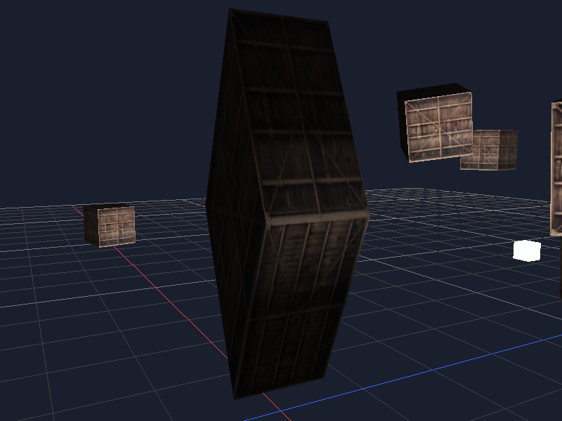 | 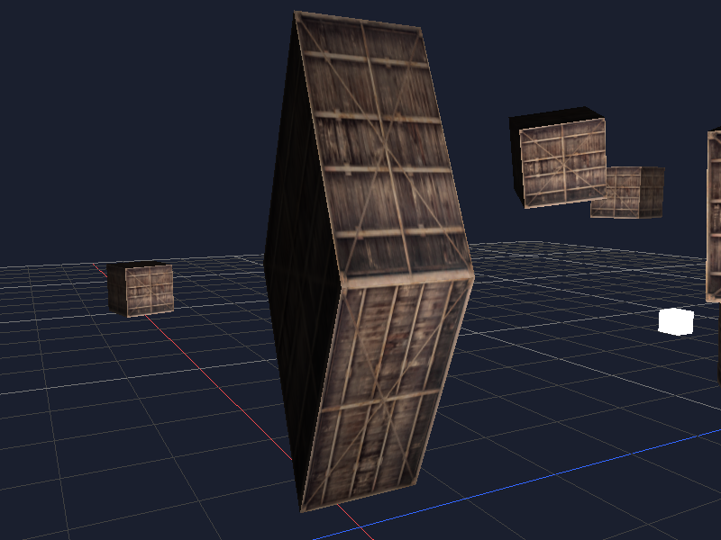 |

А нұсқасында жарыққа тура қараған екі қиғаш жақ күңгірт. Олардың нормальдары
жоғары/төмен «жатып» қалған, сондықтан жарық басқа жақтан түскендей көрінеді.

**Қолмен есептеу.** Оң жақтың локальдық нормалі `n = (1, 0, 0)`.
`M = S · R`, мұнда `S = diag(1, 2.5, 1)`, `R` — z осі бойынша 45° бұру.

`R · n = (0.7071, 0.7071, 0)`

**А нұсқасы:** `M · n = S · (0.7071, 0.7071, 0) = (0.7071, 1.7678, 0)`

```
|(0.7071, 1.7678, 0)| = √(0.5 + 3.125) = √3.625 = 1.9039
A = (0.371, 0.928, 0)
```

**Б нұсқасы:** `(M⁻¹)ᵀ = ((S·R)⁻¹)ᵀ = (R⁻¹·S⁻¹)ᵀ = S⁻¹ᵀ · R⁻¹ᵀ = S⁻¹ · R`
(`S` диагональ, ал `R` ортогональ болғандықтан `R⁻¹ᵀ = R`).

```
S⁻¹ · R · n = diag(1, 0.4, 1) · (0.7071, 0.7071, 0) = (0.7071, 0.2828, 0)
|(0.7071, 0.2828, 0)| = √(0.5 + 0.08) = 0.7616
B = (0.928, 0.371, 0)
```

**Арасындағы бұрыш:**

```
A · B = 0.371 · 0.928 + 0.928 · 0.371 = 0.689
θ = arccos(0.689) ≈ 46.4°
```

**Тексеру — қайсысы бетке перпендикуляр?** Сол жақтың жанамасы
`t = (0, 1, 0)`. Ол `M · t = S · R · t = S · (−0.7071, 0.7071, 0) = (−0.7071, 1.7678, 0)`
болып түрленеді.

```
A · T' = 0.371·(−0.7071) + 0.928·1.7678 = −0.262 + 1.641 = 1.379  ≠ 0   ҚАТЕ
B · T' = 0.928·(−0.7071) + 0.371·1.7678 = −0.656 + 0.656 = 0          ✓
```

**Қосымша сұрақ: `scale` жолын алып тастаса?** Екі нұсқа **бірдей** нәтиже
береді. Онда `M = R` — таза бұру, ал бұру матрицасы ортогональ:
`R⁻¹ = Rᵀ`, демек `(R⁻¹)ᵀ = (Rᵀ)ᵀ = R`. Бірдей масштаб `k·R` болса да
`(k·R)⁻ᵀ = R / k`. Бағыты сол, тек ұзындығы өзгереді, оны `normalize` түзетеді.
Нормаль матрицасы тек **бірдей емес** масштабта керек. Сахнадағы басқа
кубтарда масштаб жоқ, сондықтан оларда А мен Б айырмашылығы көрінбейді
(скриншоттардағы оң жақтағы кубтар екеуінде бірдей).

## 4-тапсырма: ambient-ті пернемен басқару (O / L)

```cpp
if (glfwGetKey(window, GLFW_KEY_O) == GLFW_PRESS) ls.ambient += 0.3f * dt;
if (glfwGetKey(window, GLFW_KEY_L) == GLFW_PRESS) ls.ambient -= 0.3f * dt;
if (ls.ambient < 0.0f) ls.ambient = 0.0f;
if (ls.ambient > 0.5f) ls.ambient = 0.5f;
```

`ambientStrength` енді uniform. Жарық артта `(2.0, 1.5, −2.0)`, сондықтан
алдыңғы жақтар көлеңкеде.

| 0.0 | 0.1 | 0.5 |
|---|---|---|
| 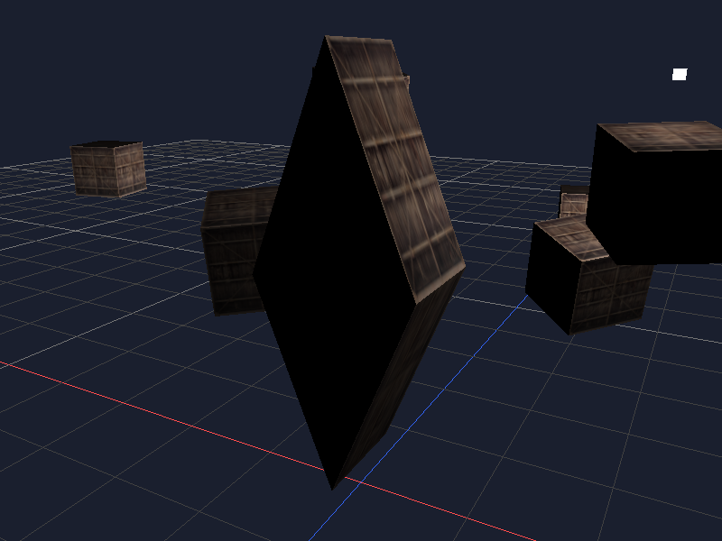 | 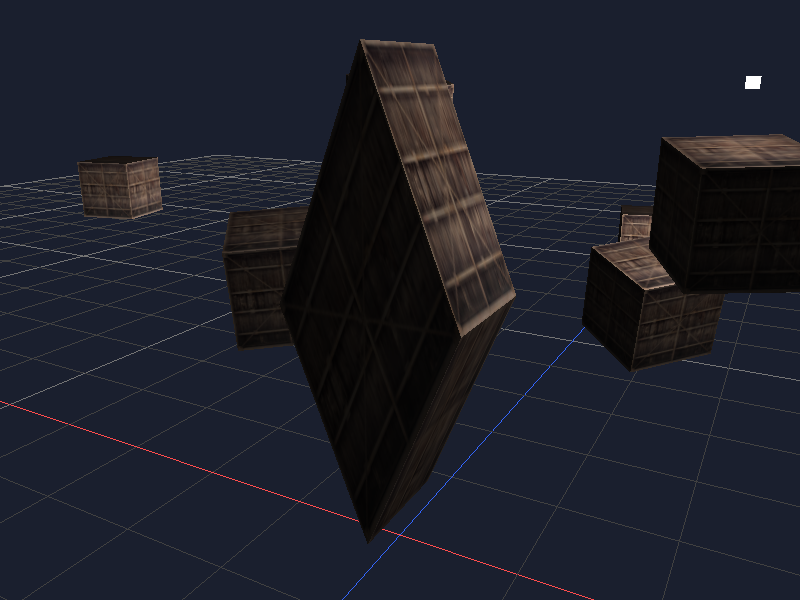 | 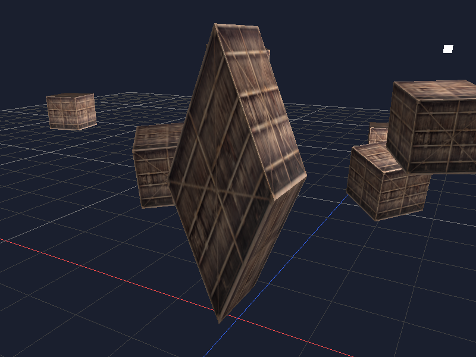 |

**0.0 мәнінде неге табиғи емес?** Көлеңкедегі жақтар толық қара болып, фонмен
араласып кетеді, кубтың пішіні жоғалады. Шын өмірде мұндай болмайды: тіпті
тікелей жарық түспейтін жерге де қабырғадан, еденнен, ауадан шағылған жарық
жетеді. Тек ғарышта ғана көлеңке осындай қап-қара.

**0.5 мәнінде ше?** Жарық пен көлеңкенің айырмасы жоғалады: көлеңкедегі жақ та
жарқырап тұр, бет жалпақ көрінеді, көлем сезілмейді. Жарықталған жақта
`0.5 + diffuse > 1` болып, түс ағарып (қиылып) кетеді.

**Ambient нені имитациялайды?** **Жанама (шағылған) жарықты.** Жарық бір
беттен екіншісіне көп рет шағылысып, кез келген нүктеге барлық бағыттан аздап
келеді. Мұны дәл есептеу (глобальдық жарықтандыру) әр нүкте үшін сахнадағы
барлық беттің бір-біріне әсерін есептеуді талап етеді: бұл рекурсивті және
нақты уақытта өте қымбат (ray tracing, radiosity). Сондықтан арзан амал
қолданамыз: барлық нүктеге бірдей шағын тұрақты қосамыз. 0.1 — физикалық шама
емес, суретшінің таңдауы.

## 5-тапсырма: Гуро шейдингі (5)

Жарық есебі (сол `lighting()` функциясы) төбелік шейдерге көшірілді:

```glsl
// төбелік шейдер
vec3 FragPos = vec3(model * vec4(aPos, 1.0));
vec3 norm    = normalize(normalMatrix * aNormal);
LightResult  = lighting(norm, FragPos);      // әр ТӨБЕГЕ бір рет

// фрагмент шейдері
FragColor = vec4(LightResult, 1.0) * texture(ourTexture, vTexCoord);
```

Бұл бөлек шейдер бағдарламасы, ал **5** пернесі екеуінің арасында ауыстырады.
Жарық алдыңғы жақтың ортасында `(0, 0, 1.2)`, жарық көзінің кубы жасырылған
(әйтпесе ең ашық нүктені жауып тұрады):

| Гуро (төбелік шейдер) | Фонг (фрагмент шейдері) |
|---|---|
| 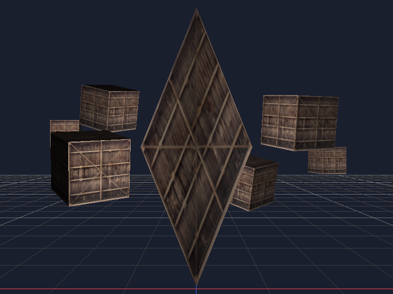 | 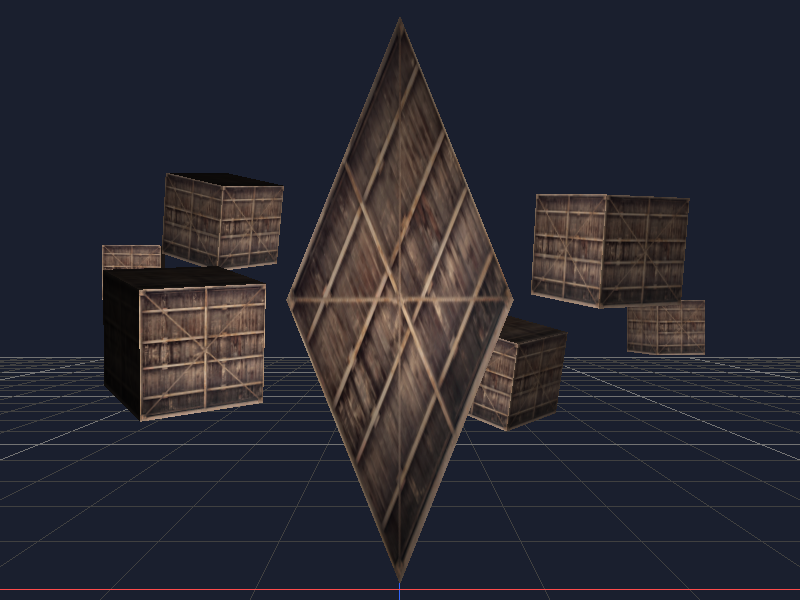 |

Фонгта алдыңғы жақтың ортасы ашық дақпен жарқырайды. Гуро нұсқасында ортасы
күңгірт, ал жарық төбелерден тегіс интерполяцияланады да, екі үшбұрышты бөлетін
тік диагональ бойынша жолақ көрінеді.

**Гуро шейдингінде ең ашық нүкте неге жоғалады?** Жарық тек төбелерде (бұл
жақта төрт бұрышта) есептеледі. Ең ашық нүкте жақтың **ортасында**: онда
`N · L = 1`. Бірақ ол жерде төбе жоқ, сондықтан бұл мән ешқашан есептелмейді.
Төбелерге жарық қиғаш түседі, мысалы `(0, 1.77, 0.5)` төбесінде `N · L ≈ 0.37`.
Ортадағы түс сол күңгірт мәндердің сызықтық орташасы ғана. Сызықтық
интерполяция ең үлкен мәнді шеттерден «ойлап таба» алмайды: ол екі төбенің
арасынан асып кетпейді.

**Екі әдіс қай жағдайда бірдей нәтиже береді?**
- Объект **ұсақ үшбұрыштарға** бөлінген болса. Төбелер жиі тұрғанда жарық
  әр төбенің арасында аз өзгереді, сызықтық интерполяция дұрыс мәнге жақын
  болады. Сондықтан ескі ойындарда модельдерге артық үшбұрыш қосатын.
- Жарық бетте сызықтық өзгерсе немесе мүлде өзгермесе. Мысалы, бағытталған
  жарық (Қ2) пен жазық жақта `N · L` бүкіл жақта тұрақты, онда Гуро мен Фонг
  дәл бірдей.

## Қосымша тапсырмалар (барлығы орындалды)

* **Қ1. Жарық көзін көрсету (H).** Жарық көзінің орнында кішкентай ақ куб
  тұрады. Сол VAO қолданылады, тек `model = translate(lightPos) · scale(0.1)`.
  Бөлек өте қарапайым шейдері бар: `FragColor = vec4(lampColor, 1.0)`.
  Әдетте ақ, ал Қ3 мен Қ4-те жарықтың өз түсімен боялады. Барлық скриншотта
  көрінеді (8, 9-да әдейі жасырылған).
* **Қ2. Бағытталған жарық (6).** `lightDirection = (−0.2, −1.0, −0.3)`,
  `lightDir = normalize(−lightDirection)`. `FragPos` diffuse есептеуге
  қатыспайды, шам кубы жасырылады.

  | Бағытталған (күн) | Нүктелік (сол камера) |
  |---|---|
  | 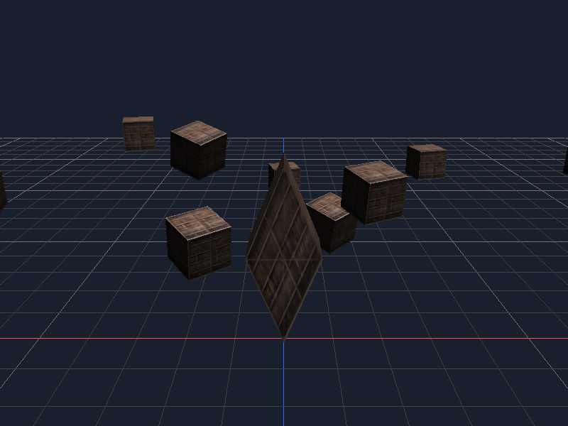 | 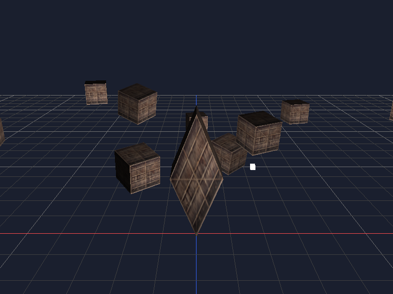 |

  **Айырмашылығы:** бағытталған жарықта жақын және алыс кубтардың **бірдей
  бағытталған** жақтары бірдей жарық. Мысалы, барлық кубтың үсті бірдей ашық,
  өйткені `L` сахнаның барлық нүктесінде бірдей. Нүктелік жарықта `L`
  фрагменттің орнына тәуелді, сондықтан бірдей бағытталған жақтар әртүрлі
  жарықталады. Жарық көзінен (`y = 1.0`) жоғары тұрған алыстағы кубтың үсті
  қап-қара (жарық астынан түседі), ал шамға жақын кубтарда жарықталған жақ
  шамның қай жағында тұрғанына байланысты ауысады. Бізде қашықтыққа байланысты
  әлсіреу (`Kc, Kl, Kq`) жоқ, ол 14-аптада. Сондықтан нүктелік жарықтағы айырма
  тек **бұрыштан** шығады, алыстағы куб өзінен-өзі күңгірт болмайды.
* **Қ3. Түрлі-түсті жарық (7).** `lightColor` уақыт бойынша өзгереді
  (`sin(t·2.0)`, `sin(t·0.7)`, `sin(t·1.3)`). Скриншот `t = 4.0` кезінде
  түсірілді: `lightColor ≈ (1.0, 0.67, 0.06)`, қызғылт сары.

  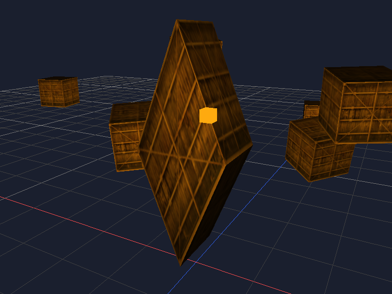

  Нәтиже **көбейтіндімен** шығады: `(ambient + diffuse) · текстура`, яғни
  әр арна бөлек көбейтіледі. Жарықта көк арна дерлік жоқ (0.06), сондықтан
  текстураның көк бөлігі жоғалып, жәшік сары-қоңыр түске боялады. Ақ жарықта
  текстура өз түсінде көрінеді. Ал жарықта жоқ түсті бет «шағылыстыра»
  алмайды.
* **Қ4. Екі жарық көзі (8).** Бірінші көз — **қызыл** `(1.0, 0.25, 0.2)`
  оң жақта, екіншісі — **көк** `(0.2, 0.45, 1.0)` сол жақта, біріншінің x
  бойынша айнадағы бейнесі.
  `result = ambient + diffuse1 + diffuse2`, ambient түсі екі көздің орташасы.

  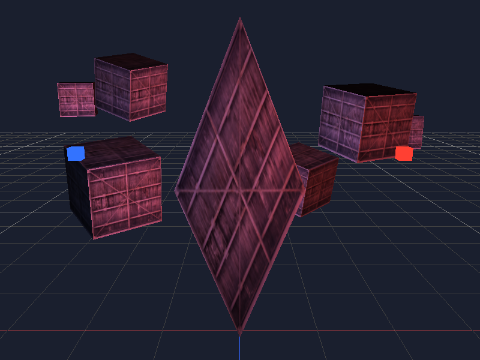

  **Түсіндіру:** оң жаққа (+x) қараған жақтар тек қызыл жарық алады, сондықтан
  қызыл. Сол жаққа (−x) қараған жақтар тек көк жарық алады. Алға (+z) қараған
  жақтарға екі көз де түседі, үлестері қосылып, **күлгін** түс шығады. Жарыққа
  қарамаған жақтарда тек ambient қалады, қараңғы. Көк үлес қызылдан әлсізірек
  көрінеді: текстура қоңыр түсті, көк арнасы аз, сондықтан көк жарықтың көп
  бөлігін «жұтып» қояды (Қ3-тегі көбейтіндінің салдары).

## Тексеру парағы

- [x] Stride үш жерде де 8
- [x] `glEnableVertexAttribArray(2)` бар
- [x] Алты жақтың нормалі дұрыс (таңбасымен)
- [x] `FragPos` `model`-мен есептелген
- [x] `normalize(Normal)` фрагмент шейдерінде бар
- [x] `max(..., 0.0)` қайтарылған (2-тапсырмада тек 2 пернесімен өшеді)
- [x] `normalMatrix` әр куб үшін бөлек есептеледі (`drawCube()` ішінде)
- [x] O / L пернелері ambient-ті өзгертеді
- [x] 9 скриншот бар (+ 6 қосымша: `03b`, `06b`, `10`, `10b`, `11`, `12`)
- [x] README толтырылған

## Файлдар

```
week13/
├── main.cpp
├── CMakeLists.txt
├── README.md
├── assets/container.png
├── docs/SETUP.md
├── external/          glad, stb
└── screenshots/       01 … 12
```
